# Ranger : Star Thrower

Rangers of this conclave read the night sky as both map and arsenal. By binding thrown weapons to a chosen constellation, they call down flashes of celestial power on their quarry and recall their star-marked arms with a gesture.

### Magical Constellation
By performing a 1-hour ritual, you can magically bind up to six weapons to a __constellation__. The weapons must have the thrown property. 
When you hit a creature with a ranged weapon attack using a __bound weapon__, the weapon attaches to the target, floating around it and following it. If the target is teleported or changes planes, the weapons detach and return to you. 
If a target has six bound weapons attached to it, it triggers the constellation's __Star Fall__, and the weapons return to you.

Constellation | Name | Star Fall
--------------|:-----|----------
 | Rose | The target takes 2d10 radiant + 2d10 poison damage, and is charmed by you for a number of turns equal to your proficiency bonus
 | Anvil | The target takes 2d10 radiant + 2d10 force damage, and must succeed on a Constitution saving throw or become stunned for a number of turns equal to half your proficiency bonus (rounded down)
 | Claw | The target takes 2d10 radiant + 2d10 necrotic damage, and is bleeding for a number of turns equal to your proficiency bonus
 | Phoenix | The target takes 2d10 radiant + 2d10 fire damage, and is burning for a number of turns equal to your proficiency bonus

### Shooting Star
At 3rd level, when you take the Attack action and throw a __bound weapon__, you can use a bonus action to throw another bound weapon at the same target.

### Shiny Recall
At 3rd level, as a bonus action, you can recall all your thrown weapons. For each recalled weapon that was attached to a creature, that creature takes radiant damage equal to your Wisdom modifier.

### Lucky Star
At 7th level, when you miss with a thrown weapon attack using a __bound weapon__, you can still attach the weapon to the target. 
You can use this trait a number of times equal to your proficiency bonus + 1. 
You regain all expended uses when you finish a long rest.

### Star Light
At 11th level, when you hit a creature with a thrown weapon attack using a __bound weapon__, you deal additional damage equal to your Wisdom modifier. 
Moreover, when you trigger __Star Fall__:
- the target must succeed on a Constitution saving throw or become blinded until the end of its next turn;
- you can expend a spell slot to add 1d10 radiant damage for each level of the slot.

### Light Speed
At 15th level, using an action, you can throw all of your __bound weapons__ at once (make separated attack rolls). Your walking speed is doubled and you don't trigger opportunity attacks until the end of your turn.